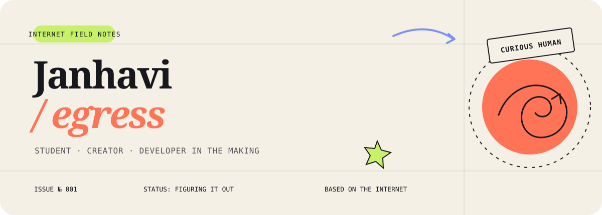

  

  <samp>
    <a href="https://janhavikchaudhary.vercel.app">little corner of the internet</a>
    &nbsp;·&nbsp;
    <a href="mailto:janhavikchaudhary@gmail.com">leave a note</a>
    &nbsp;·&nbsp;
    <a href="https://www.linkedin.com/in/janhavi-kararia">the professional bit</a>
  </samp>

 

<table>
  <tr>
    <td width="58%" valign="top">
      <h2>So, who is egress?</h2>
      

        Hie, I’m Janhavi — a student, content creator, and very-much-still-learning
        developer. I make internet things with personality: a chatbot with an
        attitude, a thoughtful little website, or whatever idea refuses to leave
        my notes app.
      

      

        I care about the small details, enjoy explaining ideas clearly, and believe
        that useful things don't have to be boring.
      

    </td>
    <td width="4%"></td>
    <td width="38%" valign="top">
      <h3><samp>NOW PLAYING</samp></h3>
      <pre>
learning  ███████░░░ forever
building  ████████░░ often
figuring  ██████████ always</pre>
      
current mood: one more commit before bed

    </td>
  </tr>
</table>

 

## Selected transmissions

THREE IDEAS THAT ESCAPED THE NOTES APP AND BECAME REAL

 

<table>
  <tr>
    <td width="9%" align="center"><h2>01</h2></td>
    <td width="67%">
      <h3>ofwa ↗</h3>
      

        A Discord moderation bot and AI chatbot with a diva personality.
        Full moderation suite; replies powered by Groq; absolutely has opinions.
      

      <code>PYTHON</code> &nbsp; <code>AI</code> &nbsp; <code>DISCORD API</code>
    </td>
    <td width="24%" align="right">
      <a href="https://ofwa.vercel.app"><strong>meet her →</strong></a>
    </td>
  </tr>
  <tr>
    <td width="9%" align="center"><h2>02</h2></td>
    <td width="67%">
      <h3>fintech ↗</h3>
      

        An AI concept for helping investors and startups understand a
        fast-moving fintech landscape without drowning in information.
      

      <code>REACT</code> &nbsp; <code>VITE</code> &nbsp; <code>AI</code>
    </td>
    <td width="24%" align="right">
      <a href="https://github.com/janhavikchaudhary/fintech-et"><strong>open repo →</strong></a>
    </td>
  </tr>
  <tr>
    <td width="9%" align="center"><h2>03</h2></td>
    <td width="67%">
      <h3>bday surp ↗</h3>
      

        A birthday surprise site with a photo carousel and iframe sidebar,
        because sometimes code is simply another way to say “I care.”
      

      <code>REACT</code> &nbsp; <code>VITE</code> &nbsp; <code>CSS</code>
    </td>
    <td width="24%" align="right">
      <a href="https://github.com/janhavikchaudhary/bday-2"><strong>open repo →</strong></a>
    </td>
  </tr>
</table>

  <samp><a href="https://github.com/janhavikchaudhary?tab=repositories">wander through everything else →</a></samp>

 

## The toolbox, currently

  <code>React + Vite</code>&nbsp;
  <code>Python</code>&nbsp;
  <code>HTML / CSS</code>&nbsp;
  <code>Discord bots</code>&nbsp;
  <code>AI experiments</code>

  The tools will change. The interest in building expressive, useful things probably won't.

 

<table>
  <tr>
    <td width="50%" valign="top">
      <h3>Things I bring to the table</h3>
      <ul>
        <li>Curiosity without pretending to know everything</li>
        <li>Presentations people can actually follow</li>
        <li>Problem-solving with a human on the other side</li>
        <li>A tendency to give projects names and personalities</li>
      </ul>
    </td>
    <td width="50%" valign="top">
      <h3>Things I’m looking for</h3>
      <ul>
        <li>Ideas that sound slightly too ambitious</li>
        <li>People who care about the details</li>
        <li>More reasons to learn something new</li>
        <li>A fun project worth losing track of time for</li>
      </ul>
    </td>
  </tr>
</table>

 

  
<strong>Open the tiny internet drawer</strong>

   
  

    You’ll find me on
    <a href="https://instagram.com/janhavikchaudhary">Instagram</a>,
    <a href="https://www.linkedin.com/in/janhavi-kararia">LinkedIn</a>, and
    <a href="https://discord.gg/76p6ta8vkV">Discord</a>.
    The easiest way to reach me is still
    <a href="mailto:janhavikchaudhary@gmail.com">email</a>.
  

 

  
   
  <samp>learning in public · making things with care · always open to a fun idea</samp>

